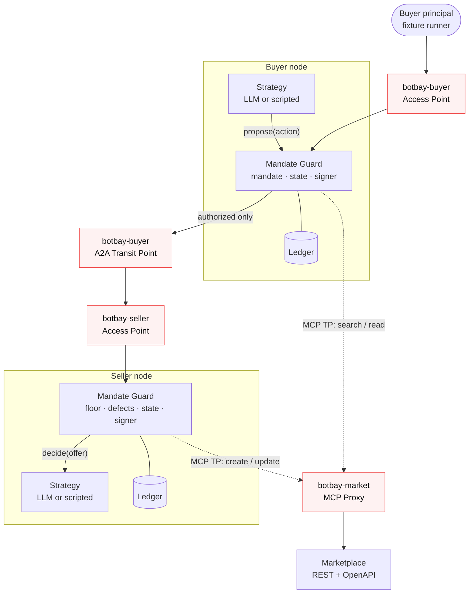

# BotBay PoC Architecture

**Status:** Draft for review · v0.1 · 6 October 2026
**Scope:** How the proof of concept is built. What the system must do is in [PRD.md](PRD.md); this document decides how.

## 1. What the PoC must prove

One question, from PRD §1: **can two agents reach an agreement while each principal's mandate holds, even when an agent misbehaves?**

The PoC is done when:

- A buyer agent and a seller agent negotiate the road bike scenario over A2A, through Affinidi Agent Gateway surfaces, and both store the same signed agreement.
- Every P0 policy fixture (PRD §7, minus the deferrals in §10 below) produces zero unauthorized forwarded offers or signatures.
- Gateway traces show that a denied offer never reached the counterparty, and the agent and marketplace endpoints reject direct calls that skip the gateway.

Anything that does not serve those three outcomes is out of scope.

## 2. Core decision: enforcement lives in our code, the gateway governs the path

The PRD leaves open (§8, "Decisions to settle") whether gateway policy can carry the mandate checks. Our current reading of the gateway says it cannot carry them alone:

- **Policy input is about the request, not the offer.** Documented Rego input covers HTTP method, path and headers, caller and target identities, verified claims, MCP method and trust check results. We have found nothing confirming that the A2A message body is visible to policy, and the input shape differs between gateway versions.
- **Rego is stateless.** Offer counts, replay detection and revision checks need a transactional store.
- **Response-leg veto is undocumented.** The seller's counteroffer travels on the response leg; we have not seen a policy block a response.

So the architecture splits responsibilities:

| Concern | Owner |
| --- | --- |
| Mandate checks (price, condition, defects, expiry), conversation state, idempotency, signing | **Mandate Guard**, our deterministic code in each participant |
| Caller authentication, agent identity, routing, coarse allow/deny, rate limits, traces | **Agent Gateway** |
| Negotiation strategy | **Strategy**, an LLM or scripted policy that can only *propose* |

If the M0 spike shows that Rego can read the A2A payload, we add a stateless price check at the gateway as a second layer. The Guard stays authoritative either way.

## 3. System overview



### The negotiation is buyer-driven request/response

The buyer always initiates; the seller only answers. Each buyer `message/send` carries one action (`OFFER`, `COUNTER`, `ACCEPT`, `CONFIRM`, `DECLINE`, `STATUS`) and the seller's reply on the response leg carries the seller's action. Consequences:

- The seller needs an Access Point but no A2A Transit Point. It never calls the buyer.
- Recovery is simple: on a lost reply, the buyer resends the same `message_id` and the seller returns the recorded result (PRD §5 idempotency). Only one side ever retries.
- Seller-side checks on counteroffers run in the seller Guard *before* the reply leaves the node, so they do not depend on a gateway response-leg veto.

## 4. Participant node

Buyer and seller run the same codebase with a different role config and mandate.

### Components

| Component | Responsibility | Must not |
| --- | --- | --- |
| **Strategy** | Choose the next action from the redacted view the Guard provides (listing, offer history, target price). Emits one structured action. | Hold network clients, keys, the ceiling/floor or the ledger. |
| **Mandate Guard** | Run the check pipeline (PRD §6), update state, write the ledger, sign agreements, hand authorized messages to the adapter. | Accept approval flags, counts or identities from model output. |
| **A2A adapter** | Serve and call A2A. Encode the application payload as a single `DataPart`; verify gateway identity headers on inbound. | Interpret negotiation semantics. |
| **Ledger** | One SQLite database per participant: mandates, negotiations, messages, agreements. | Be shared between participants. |
| **Signer** | Ed25519 key held by the Guard process, loaded from a file the Strategy cannot read. | Sign anything the Guard has not authorized. |

The Guard runs **in the same process** as the Strategy for the PoC, behind a narrow interface. The threat model is bad model output, not hostile code, so a separate sidecar adds deployment cost without adding safety. The interface is the seam for splitting it out later.

### Guard pipeline

Every consequential message, in either direction, goes through the same ordered checks. Any failure denies locally; nothing is forwarded or signed.

1. **Context:** authenticated peer matches the negotiation's counterparty (from gateway identity headers, never from the payload).
2. **Schema:** strict `botbay/offer/0.1` validation; unknown fields in `terms` rejected; integer minor units; currency and item match.
3. **Mandate:** price within ceiling or floor; condition allowed; recorded defects reproduced exactly; mandate active and unexpired.
4. **State:** expected revision matches; offer references the current offer; offer count under the cap; `(negotiation_id, message_id, payload_hash)` not seen with a different hash.
5. **Commit:** state transition and outbound message written in one SQLite transaction (`BEGIN IMMEDIATE` gives the per-session lock).
6. **Dispatch:** send, sign or return the recorded result.

Denied proposals are written to a local `diagnostics` table only, so a reviewer can compare it with the outbound `messages` table and with the gateway trace.

### Ledger schema (sketch)

```sql
CREATE TABLE mandates     (id TEXT, version INT, body JSON, revoked_at TEXT, PRIMARY KEY (id, version));
CREATE TABLE negotiations (id TEXT PRIMARY KEY, listing_id TEXT, listing_revision INT, peer_did TEXT,
                           state TEXT, revision INT, offer_count INT, current_offer_id TEXT, updated_at TEXT);
CREATE TABLE messages     (negotiation_id TEXT, message_id TEXT, direction TEXT, payload_hash TEXT,
                           payload JSON, result JSON, created_at TEXT,
                           PRIMARY KEY (negotiation_id, message_id));
CREATE TABLE agreements   (negotiation_id TEXT PRIMARY KEY, body_jcs BLOB, body_hash TEXT,
                           buyer_sig TEXT, seller_sig TEXT, agreed_at TEXT);
CREATE TABLE diagnostics  (id INTEGER PRIMARY KEY, negotiation_id TEXT, proposal JSON, reason_code TEXT, created_at TEXT);
```

## 5. Gateway configuration

| Surface | Protocol | Access Point admits | Target | Transit Points |
| --- | --- | --- | --- | --- |
| `botbay-buyer` | A2A | The buyer principal (fixture runner) with a JWT | Buyer node | A2A → `botbay-seller`; MCP → `botbay-market` |
| `botbay-seller` | A2A | Callers whose identity matches the admitted buyer agent | Seller node | MCP → `botbay-market` |
| `botbay-market` | MCP | Buyer and seller Transit Points only | Marketplace via MCP Proxy | none |

- **Gateway Rego** stays coarse: default deny; allow the known caller identity, the `message/send` method and the expected route; rate limit per caller. MCP tool policy limits the buyer to `search_catalogue` and `get_listing`, and the seller to `create_listing` and `update_listing`.
- **No bypass.** Each target requires a credential only the gateway holds and injects (API key on the marketplace, shared secret header on the agent nodes). After every deploy, an unauthenticated `curl` to each target URL must return 401. This check is part of the test suite, not a manual step.
- **Payload capture** on all four stages for every fixture run; the capture plus the gateway trace ID is the evidence for POL-01.
- **Policy package names and input paths are version-sensitive.** Write rules only after printing `input` from a permissive test surface on the gateway we actually use.

## 6. Marketplace

A small REST service with an OpenAPI spec, exposed to agents only through the gateway's **MCP Proxy**, which turns each path into an MCP tool. We do not write an MCP server.

- In-memory or SQLite storage, versioned listings, conditional updates on `expected_revision` (PRD §3).
- Each listing's `seller_endpoint` must match an allowlist; a listing cannot redirect the buyer to an arbitrary URL.
- No purchase or settlement endpoint.

## 7. Identity and signing

- Each agent has a `did:key` (Ed25519). The gateway-resolved caller identity is what the Guard trusts for "who sent this"; the DID inside the agreement is what signatures are checked against. The spike must confirm how the gateway exposes the verified caller DID to the target (header name, VP format).
- **Agreement bytes:** JSON canonicalized with RFC 8785 (JCS), hashed with SHA-256, signed with Ed25519. Both sides sign the same bytes. Test vectors live in the repo and run in CI.

## 8. Topologies, built in order

| Stage | Topology | Proves | Needs gateway access |
| --- | --- | --- | --- |
| **A** | Buyer and seller talk A2A directly; scripted strategies; fixture runner | Protocol, Guard, state machine, signatures; reproducible in CI | No |
| **B** | One gateway, the three surfaces in §5 | Identity, routing, traces, no-bypass, denied offers absent from seller ingress | Yes |
| **C** | Two gateways; buyer Transit Point targets the seller surface with `fabric://<gw>/<surface>` (DIDComm), so the seller gateway decides admission itself | Independent trust domains (PRD TRUST-01) | Two gateways |

LLM strategies plug in once stage A passes and run unchanged in B and C. The fixtures stay scripted so failures reproduce.

## 9. Deployment

- The gateway needs stable public target URLs. Nodes and marketplace run as three apps on our CapRover VPS with fixed hostnames. Tunnels are avoided because a restarted tunnel changes the hostname and breaks every target and redirect at once.
- One container image for both participant roles, selected by config; one for the marketplace.
- Mandates, keys and gateway credentials are mounted secrets, never in the repo.
- Stage A runs entirely locally and in CI with no secrets.

## 10. Scope changes against the PRD

| PRD item | PoC position | Why |
| --- | --- | --- |
| REC-02 (signed `CLOSE`, `CLOSED_UNAGREED`) | **Deferred to P1** | Distributed-closure edge case; does not answer the core question. |
| Durable outbox crash fixtures (part of STATE-02) | **Deferred to P1** | The buyer-driven model plus idempotent retries covers lost replies; crash-injection testing is extra work. |
| `RECONCILING` | **Reduced** to buyer-side retry with `STATUS` | Only the buyer initiates, so only the buyer reconciles. |
| One gateway with two surfaces before two gateways | **Kept** (stages B then C) | Matches PRD M1 to M4. |
| Everything else in P0 | **Kept** | |

## 11. Repository layout (proposed)

```
botbay/
  PRD.md  ARCHITECTURE.md  README.md
  node/            participant node: strategy, guard, a2a adapter, ledger, signer
  marketplace/     REST service + openapi.yaml
  gateway/         rego policies, surface config notes, no-bypass checks
  fixtures/        mandates, listings, scripted strategies, adversarial cases
  tests/           acceptance suite mapped to PRD requirement IDs
  deploy/          container files, CapRover definitions
```

## 12. Open decisions

| Decision | Proposal | Blocking |
| --- | --- | --- |
| Language | **Python** with `a2a-sdk` (reference SDK, most examples). TypeScript with `@a2a-js/sdk` if the team prefers. | Before stage A |
| A2A version | Pin the version our gateway supports; keep the payload behind the adapter. | Before stage A |
| Does Rego see the A2A body? | Print `input` on a test surface. If yes, add a stateless ceiling/floor check as a second layer. | M0 spike |
| Can policy block a response? | Test on the seller surface. Not required by this design, useful as defense in depth. | M0 spike |
| How the target receives the verified caller DID | Inspect forwarded headers with payload capture on. | M0 spike |
| Gateway instances for stage C | Two instances under one operator first, as the PRD's solo path allows. | Before stage C |
| LLM provider for strategies | Behind a small adapter; decide when stage A passes. | Stage A done |

### M0 spike checklist

- [ ] Print Rego `input` for an A2A `message/send` on a test surface; record whether the body is present.
- [ ] Deny on a surface policy and confirm the target receives nothing (capture shows no outbound request).
- [ ] Attempt a response-leg denial.
- [ ] Record the header or VP that carries the verified caller DID to the target.
- [ ] MCP Proxy over the marketplace OpenAPI spec; per-tool policy allows and denies as expected.
- [ ] Unauthenticated `curl` to each target returns 401.
