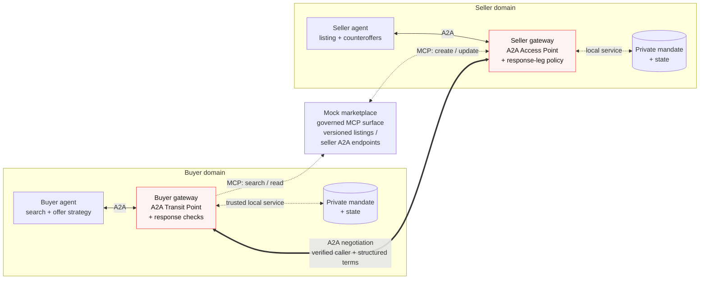
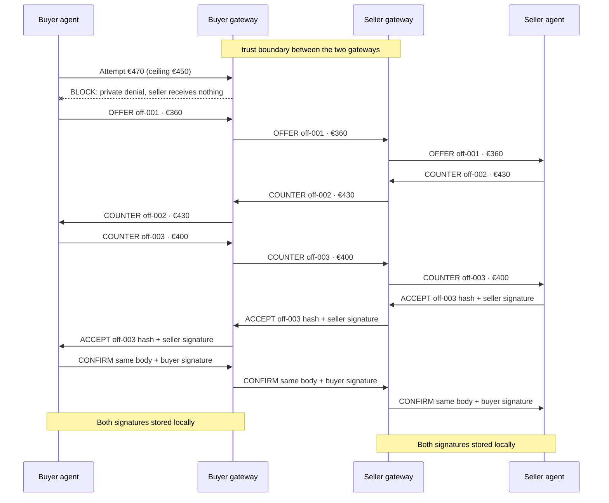
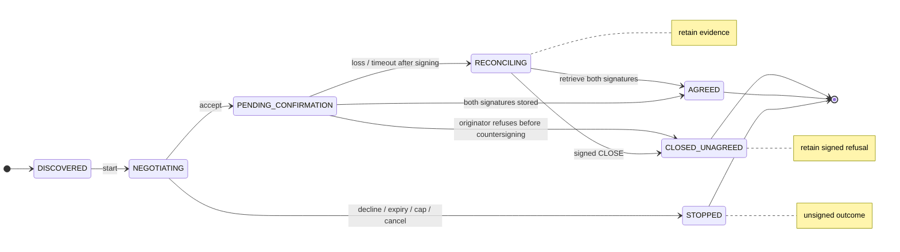
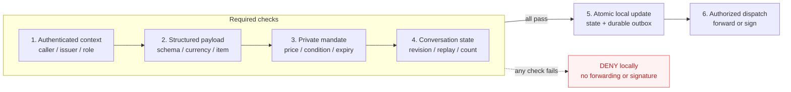

# BotBay

A2A negotiation under gateway-enforced mandates.

**Document:** Product & technical requirements · v0.2 · 15 September 2026  
**Author:** mhrsntrk · **Status:** Proposed; implementation has not started.

## 1. What it is

BotBay is an experiment in delegated commerce. A buyer agent discovers a second-hand listing and negotiates with a seller agent over A2A. Each agent represents a different principal, operates under a private mandate, and sends its offers through a gateway that enforces that principal’s rules.

The first scenario is a used road bike. The buyer authorizes a maximum total price of **€450** and accepts a defined condition range. The seller sets a **€340** floor and records the bike’s condition and known defects. The agents may negotiate within those constraints. An offer outside the sender’s authority must be rejected before it reaches the counterparty.

### What it does

1. Publishes seller-managed listings to a mock marketplace and lets a buyer agent search them through MCP tools.
2. Starts an A2A conversation with the seller agent associated with a matching listing.
3. Exchanges structured offers and counteroffers, applying local mandate, identity and conversation-state checks on the relevant gateway legs.
4. Produces a signed agreement record when both sides approve the same terms, or an explicit terminal outcome with a reason and transcript references.
5. Lets the principal inspect the negotiation, revoke unused authority, and understand why an offer or negotiation was stopped.

### The problem and the experiment

A spending instruction in an agent’s prompt does not, by itself, create an enforceable limit on the messages the runtime can send. This project puts that authority in a deterministic control path. The agent chooses a strategy; the policy layer decides whether a proposed action is authorized.

The experiment has two questions: **can two agents reach useful agreements, and can the system preserve each principal’s constraints when an agent or counterparty behaves incorrectly?** Agreement rate and policy correctness will be measured separately.

### Initial scope

| In the first build | Deferred |
| --- | --- |
| One buyer, one seller, one active negotiation per listing | Multi-buyer auctions and concurrent inventory reservations |
| Mock marketplace, seller publishing, buyer discovery | Production marketplace integrations |
| EUR prices in integer minor units; collection only | Payments, shipping, tax and currency conversion |
| Structured negotiation, gateway checks, signed outcome | Legal contract execution and dispute resolution |
| Recorded condition and defect consistency | Physical inspection or proof that a listing is truthful |

All rules below are **proposed requirements**, not claims of implemented behavior. The gateway integration spike must establish which checks can run on the deployed gateway and which require a local enforcement service.

## 2. Actors and system architecture

The target topology has two independently administered gateways. A smaller deployment uses one gateway with separate buyer and seller surfaces to prove the local loop first.



*Independent administration: each domain keeps its mandate private.*

### Component responsibilities

| Component | Owns | Must not own |
| --- | --- | --- |
| Buyer principal | Search criteria, budget, allowed condition, expiry and revocation | Per-turn negotiation decisions |
| Seller principal | Listing facts, floor price, disclosure requirements | The buyer’s mandate |
| Buyer agent | Listing selection, opening offer, counteroffer strategy | Writing or increasing its own hard limits |
| Seller agent | Listing maintenance, pricing strategy, accept/counter/decline proposals | Removing recorded defects to obtain acceptance |
| Each gateway | Governed ingress/egress, caller verification, attached policies and traces | The other principal’s private mandate |
| Local policy/state service | Mandate versions, validated negotiation state, deduplication and receipt storage | Trusting a model-supplied state or approval flag |
| Mock marketplace + MCP adapter | Versioned listings and seller A2A endpoints; search and listing tools | Accepting offers or settling a deal |

**Required traffic path:** agents must reach the other side through configured Transit Points. A2A service endpoints and marketplace backends must reject direct, ungoverned access. Merely configuring a gateway while leaving bypass routes available does not satisfy the experiment.

### Proposed Affinidi surface mapping

- **Buyer A2A surface:** an Access Point invokes the buyer runtime. Its A2A Transit Point targets the seller’s Access Point. Its MCP Transit Point reaches the marketplace’s governed MCP surface.
- **Seller A2A surface:** its Access Point admits the buyer’s calls and forwards them to the seller runtime. A response-leg policy validates seller counteroffers and acceptances before returning them. A separate MCP Transit Point permits listing publication and updates.
- **Marketplace MCP surface:** exposes `search_catalogue`, `get_listing`, `create_listing` and `update_listing`. If the backing service is REST, an MCP adapter/proxy supplies the protocol interface.
- **Private policy/state service:** supplies trusted mandate data and state decisions. Its concrete attachment mechanism is an implementation dependency: verify payload visibility, response-leg veto behavior, state access and failure handling before treating enforcement as complete.

Transit Points are the gateway’s agent-initiated outbound routes, with destination-scoped policies. The seller’s reply travels on the response leg, which is distinct from a seller-initiated outbound call. See the [Affinidi Transit Point reference](https://docs.affinidi.com/products/affinidi-trust-fabric/agent-gateway/reference/surfaces/transit-points/) and [outbound policy guide](https://docs.affinidi.com/products/affinidi-trust-fabric/agent-gateway/how-to-guides/policies/apply-policy-to-outbound-calls/).

## 3. Mandates and marketplace contract

A mandate is a principal-authored, versioned authorization document. Agents can read only the fields they need. They cannot replace a mandate, expand a hard limit or approve their own exception. Counterparties receive offer terms, never the complete private mandate.

### Example mandates

These are separate local documents, shown together for review. Monetary values are integer euro cents. The buyer’s ceiling covers the complete price in this collection-only scenario.

```json
{
  "mandate_id": "buyer-001",
  "version": 1,
  "principal_id": "did:example:buyer",
  "role": "buyer",
  "item": {"category": "bicycle.road", "size_cm": 58},
  "currency": "EUR",
  "ceiling_minor": 45000,
  "target_minor": 38000,
  "accepted_condition": ["like_new", "good"],
  "max_offers": 6,
  "expires_at": "2026-09-16T12:00:00Z"
}
```

```json
{
  "mandate_id": "seller-001",
  "version": 1,
  "principal_id": "did:example:seller",
  "role": "seller",
  "listing_id": "lst_8841",
  "listing_revision": 4,
  "currency": "EUR",
  "floor_minor": 34000,
  "condition": "good",
  "known_defects": ["small chip on top tube"],
  "max_offers": 6,
  "expires_at": "2026-09-16T12:00:00Z"
}
```

**Hard constraints:** price ceiling/floor, currency, item identity, condition, required defect disclosure, offer count, validity and revocation. **Strategy inputs:** target price, opening discount and concession curve. Strategy can change without increasing authority.

A session pins both its local mandate version and the listing revision. A changed listing requires a fresh evaluation. Revocation stops new offers and agreement signatures; authenticated closure and status responses remain permitted. If an agreement signature has already been released, the controller reconciles the existing outcome rather than claiming that revocation erases it.

### Marketplace tools

| Tool | Authorized actor | Required behavior |
| --- | --- | --- |
| `search_catalogue(filters, cursor)` | Buyer | Return matching listing summaries, revisions and seller A2A endpoint references. |
| `get_listing(listing_id)` | Buyer or seller | Return current price, currency, condition, defects, availability and revision. |
| `create_listing(listing)` | Seller | Assign an ID; bind ownership to the authenticated seller. |
| `update_listing(id, expected_revision, patch)` | Owning seller | Apply a conditional update; reject a stale revision or different owner. |

No tool accepts a purchase. Seller endpoints are validated against the configured destination/trust policy before contact; a listing cannot direct an agent to an arbitrary internal URL. Listing text is untrusted content and cannot modify mandates or gateway configuration.

## 4. Negotiation protocol and message contract

A2A carries the interaction. The negotiation vocabulary and financial terms are an **application-level contract** carried as structured data, with optional explanatory text. Text alone cannot create, counter or accept an offer.

Pin the A2A version supported by both agents and the gateway during the integration spike. The examples below deliberately show the application payload, not an assumed transport envelope. Agent Cards, authentication requirements and structured message transport follow the pinned [A2A specification](https://a2a-protocol.org/latest/specification/). Marketplace tools use [MCP tools](https://modelcontextprotocol.io/specification/2025-11-25/server/tools).



### Application message types

| Type | Effect |
| --- | --- |
| `OFFER` / `COUNTER` | Propose complete terms and an expiry. A counteroffer supersedes the referenced current offer. |
| `ACCEPT` | Accept the exact current offer hash and attach the acceptor’s signature after local checks. |
| `CONFIRM` | Return the same agreement body with both signatures after the offer originator revalidates and signs. |
| `DECLINE` / `CANCEL` | Stop an unsigned negotiation with a machine-readable reason. |
| `CLOSE` | Signed refusal by the offer originator when it has not countersigned; closes a partially signed attempt without claiming agreement. |
| `STATUS` | Reconcile state and retrieve an existing receipt after a lost reply; does not create an offer. |

```json
{
  "schema": "botbay/offer/0.1",
  "message_id": "msg-003",
  "negotiation_id": "neg-8841",
  "type": "COUNTER",
  "offer_id": "off-003",
  "replaces_offer_id": "off-002",
  "expected_revision": 2,
  "listing_id": "lst_8841",
  "listing_revision": 4,
  "terms": {
    "price_minor": 40000,
    "currency": "EUR",
    "condition": "good",
    "known_defects": ["small chip on top tube"],
    "handover": "collection"
  },
  "expires_at": "2026-09-15T16:30:00Z"
}
```

The runtime binds the sender to authenticated identity; a role or principal ID in a payload is not sufficient evidence. Mandate IDs and internal policy explanations remain local. A peer-visible response must not reveal the buyer’s ceiling or seller’s floor.

### Round and retry semantics

The initial limit is **six authorized offers in total**, counting the opening offer and counteroffers from either side. Acceptance, confirmation, status requests and identical retries do not consume another offer. An acceptance of the sixth offer is allowed while that offer remains valid. Each side can impose a stricter local cap without disclosing it.

Use one outstanding offer at a time. A new counteroffer must name the current offer and state revision. Locally blocked attempts do not consume the shared offer count; a separate local attempt/rate limit stops an agent retrying indefinitely. Proposed starting values: three invalid attempts, a five-minute session deadline and bounded retries with backoff. These are tuning defaults, not protocol requirements.

## 5. State, agreement and recovery

Each participant stores its own authoritative session ledger. The model’s conversation history is not the state database. A2A `contextId` provides correlation; it does not replace application-level ordering or duplicate handling. A2A makes send-message idempotency optional, so this application must define its own behavior.



### State rules

| State | Allowed progression |
| --- | --- |
| `DISCOVERED` | Read and validate the listing, choose a compatible seller endpoint and create a session. |
| `NEGOTIATING` | Admit a valid offer/counteroffer, accept the current offer, or stop. |
| `PENDING_CONFIRMATION` | A signature has been issued; persist it and finish or reconcile the signature exchange. |
| `AGREED` | The local store holds a valid agreement body with both parties’ signatures. New price changes are rejected. |
| `STOPPED` | Unsigned negotiation declined, cancelled, expired or exhausted. Record the reason; a restart needs a new session. |
| `RECONCILING` | Delivery or final state is uncertain. Query/retry the same operation; do not silently create a new deal. |
| `CLOSED_UNAGREED` | The originator has durably refused to countersign. Retain the first signature and authenticated closure evidence; reject future confirmation for this session. |

### Idempotency and atomic local updates

- Persist `(negotiation_id, message_id, payload_hash, result)` under a uniqueness constraint. A retry with the same ID and hash returns the recorded result; a different hash under that ID is rejected.
- Validate the expected revision, update local state and record the outbound message in one transaction. Dispatch from a durable outbox so a crash cannot silently lose an authorized event.
- On a stale counteroffer, unexpected sender, expired offer or revision gap, reject the mutation and reconcile. A per-session lock or compare-and-swap must prevent two simultaneous transitions from both succeeding.
- Keep raw failed proposals in local diagnostics only. Record outbound authorized messages separately so a reviewer can prove that a denied offer never crossed the boundary.

### Agreement record

The agreement body contains the negotiation and offer IDs, exact final terms, listing revision, both agent/principal identity references, validity and a schema version. Both parties sign the **same canonical bytes**. The choice of canonical encoding and signature suite must be fixed before receipt interoperability testing.

On `ACCEPT`, the acceptor rechecks its mandate, records and signs the agreement body. The offer originator verifies the signature and exact terms, rechecks its own still-valid authority, then signs and returns `CONFIRM`. Each side reaches `AGREED` only after storing both signatures over the same body.

A lost confirmation can leave one side agreed while the other is reconciling. This is not an atomic distributed transaction. Preserve the pending record and retry/status-query idempotently; do not report “no deal” merely because a response timed out. If the originator’s authority expires or is revoked before it countersigns, it atomically records a refusal tombstone and emits a signed `CLOSE` referencing the negotiation ID, offer hash and reason. This transition is allowed only if no countersignature has been issued; an existing countersignature instead returns the agreed record. Once closed, the originator must never issue `CONFIRM` for that session.

The other side enters `CLOSED_UNAGREED` only after verifying that originator-signed refusal, retaining its first signature and the closure proof. A timeout alone cannot establish refusal: unreachable peers remain `RECONCILING` and are surfaced to the principal. Signing output must be persisted before dispatch, so a restart cannot alternate between confirmation and closure.

The record demonstrates what was authorized in the experiment; payment and legal enforceability are separate work.

## 6. Policy enforcement and trust boundaries

Every consequential outbound message must pass the sender’s checks; incoming messages must pass the receiver’s admission checks. A valid signature identifies a signing key. Authorization additionally depends on the locally accepted issuer, identity binding and role for this negotiation.



*State decisions come from trusted storage, never model-supplied approval flags.*

| Enforcement point | Required checks | Failure result |
| --- | --- | --- |
| Gateway entry / global policy | Enabled route, authenticated caller, allowed category, rate limit and operator stop switch | Reject; do not invoke the agent |
| Buyer A2A Transit Point | Valid structured terms; matching item and currency; total price at or below ceiling; allowed condition; active mandate and state | Block locally; return a private policy reason |
| Seller Access Point | Accepted caller/gateway identity evidence, valid payload and session binding, freshness and rate limit | Reject before seller invocation |
| Seller response leg | Offer/acceptance at or above floor; exact recorded condition and required defects; current session and mandate | Block response; do not disclose the private floor |
| Buyer return path | Authenticate seller evidence, validate received terms and proposal references before handing them to the buyer agent | Reject or reconcile; do not treat text as acceptance |
| Either side before agreement signing | Revalidate all final terms, latest offer hash, mandate validity/revocation and local state; persist authorization atomically | No agreement signature; preserve a diagnosable local result |

### Rules the implementation must preserve

**Fail closed.** A policy error, unavailable mandatory state service, malformed payload or unverifiable required identity evidence cannot become an allow. The gateway must expose a usable reject path on both request and response legs.

**No bypass.** The agent cannot reach the counterparty, signer or marketplace backend with credentials that circumvent the governed path. The signing key is held by the gateway or a trusted local service, outside the model runtime.

**No model-authored authority.** Load mandate/state data from trusted local storage. Ignore payload fields such as `approved: true`; reject unknown fields in consequential terms. Do not accept a model’s reported round count or principal identity as authoritative.

**Disclosure is constrained, not magically proven.** Require seller messages to reproduce the recorded condition and known defects. That validates consistency with the seller’s record, not the physical bike. Keep reserve prices out of peer-visible payloads and errors; bargaining behavior may still let a counterparty infer them.

**Traceable decisions.** Log message ID, local mandate version, policy version, decision, reason code, before/after revision and trace ID. Protect raw payload logs as local data. A shared evaluation bundle contains authorized traffic and redacted outcomes; private mandates are disclosed only deliberately for a test.

Gateway policy-input paths and the identity mechanism are version-sensitive. The spike must verify them on the intended deployment, including the difference between self-asserted identity fields and a binding derived from authenticated caller evidence.

## 7. Requirements and acceptance criteria

P0 is the minimum complete experiment. P1 expands independence and evaluation. P2 is future scope.

| ID | Priority | Requirement and acceptance criterion |
| --- | --- | --- |
| DISC-01 | P0 | Seller creates a versioned listing; buyer discovers it through MCP and resolves a permitted seller endpoint. A direct backend call is rejected. |
| AUTH-01 | P0 | Principal creates/revokes a versioned mandate. An agent’s attempt to alter its ceiling, floor or validity is denied. |
| NEG-01 | P0 | Two runtimes exchange structured offers through gateway paths. A deterministic fixture reaches a matching agreement at €400. |
| POL-01 | P0 | With a €450 ceiling, a €470 buyer offer is locally denied and absent from seller ingress traces. €450 is allowed by the price check. |
| POL-02 | P0 | A seller response below €340 is blocked; €340 passes the floor check. Acceptance also checks the floor. |
| POL-03 | P0 | A missing currency, wrong listing revision, omitted recorded defect, expired mandate or policy evaluation error produces no authorized offer/signature. |
| STATE-01 | P0 | The seventh offer is rejected; acceptance of the sixth remains possible. An identical retry creates no extra offer or state transition. |
| STATE-02 | P0 | Same ID/different payload, stale offer and concurrent conflicting transitions fail deterministically. A crash/retry recovers the persisted result. |
| REC-01 | P0 | Both sides verify signatures over identical agreement bytes. A lost confirmation enters reconciliation and eventually returns the existing record after connectivity recovers. |
| REC-02 | P0 | Revoke/expire the originator’s mandate after `ACCEPT` but before countersigning. Both sides converge on `CLOSED_UNAGREED` after a valid `CLOSE`; retain the first signature and reject subsequent `CONFIRM`. A timeout without closure proof remains unresolved. |
| OPS-01 | P0 | Every terminal result includes reason, final state, offer count and trace references. Revocation and stop controls are exercised. |
| TRUST-01 | P1 | Two gateways run under separate configurations. A caller not admitted by the seller’s trust policy never reaches the seller agent. |
| EVAL-01 | P1 | Run multiple agent strategies against fixed listings and adversarial fixtures; compare utility, cost and failure modes separately from correctness. |
| PAY-01 | P2 | Evaluate payment authorization only after negotiation and receipt behavior is stable; no payment protocol is assumed in P0. |

### Evaluation plan

First use scripted agents to make failures reproducible, then replace them with LLM-driven strategies. Keep the same contract fixtures and enforcement path in both modes.

For each run, capture final state, offers, rejected attempts, rejection reason, final price, latency, model token/cost usage when available, and whether both receipt hashes match. For eligible negotiations, report agreement rate and distance from each side’s target. Report no-deal outcomes separately from policy failures.

The P0 correctness gate is **zero unauthorized forwarded offers or signatures in the defined acceptance suite**, plus successful recovery in the replay, crash and lost-confirmation fixtures. This is a test threshold, not a universal security claim. No agreement-rate target is asserted before a baseline exists.

## 8. Implementation plan and open decisions

### Milestones

| Milestone | Deliverable | Exit condition |
| --- | --- | --- |
| M0 · Integration spike | Pin gateway/A2A/MCP compatibility. Prove request and response payload inspection, denial propagation, identity verification and trusted policy/state access. | A deliberately invalid proposal is stopped on each required leg. Document unsupported hooks before proceeding. |
| M1 · Local fixture | Mock catalogue + MCP tools, two scripted agents, private mandate stores and a persisted session controller. | Discovery, counteroffers, expiry and a deterministic agreement work through one gateway with separate surfaces. |
| M2 · Enforced negotiation | Price/condition/state policies, deduplication, durable outbox, signing and receipt reconciliation. | The P0 acceptance suite passes, including denial, replay and failure cases. |
| M3 · Agent strategies | LLM buyer and seller runtimes constrained to the same action schema. | Collect a baseline for useful bargaining, cost and rejected attempts. |
| M4 · Independent gateways | Move one participant to a second gateway; repeat the fixtures and trust tests. | Both sides verify the same outcomes while owning separate policies and credentials. |

**Solo path:** one developer can implement M0–M3 and operate two separate gateway instances for M4. Two instances under one operator validate separation of configuration and routing; independent operators add a stronger test of setup assumptions and trust policy.

**Suggested starting implementation:** small agent services, a mock catalogue service, one local transactional store per participant, gateway configuration/policy definitions and a fixture runner. Keep the model adapter replaceable. The language, agent framework and database are implementation choices, not protocol requirements.

### Decisions to settle

| Decision | When | Proposed starting position |
| --- | --- | --- |
| Payload visibility and policy/state integration on each gateway leg | M0, blocking | Inspect actual policy input and prove a response can be vetoed. A stateless Rego decision alone does not provide transactional state. |
| Agent/principal binding and trusted issuers | M0, blocking | Use authenticated callers and explicit local admission policy. Do not equate a self-asserted descriptor with verified principal authority. |
| Common A2A version and capability mapping | M0, blocking | Pin one shared version and keep negotiation payloads behind a transport adapter. |
| Canonical agreement bytes and signing suite | Before M2 receipts | Choose one deterministic encoding and one mutually supported signature format; ship test vectors. |
| Mandate visibility to the model | Before M3 | Expose strategy inputs narrowly; keep reserve limits and signing authority in the enforcement service where possible. |
| Session deadline, clock tolerance and invalid-attempt cap | M1–M3 | Begin with bounded defaults, then tune from fixtures and measured outcomes. |
| Bargaining strategy and human handoff | M3 | Compare a simple deterministic baseline with model-driven negotiation; explain each no-deal outcome. |

### Related work

Potential Agent Lab integration points are `cross-boundary-a2a` for the two-gateway exercise, `guard-an-agent` for policy challenges and, later, `agent-buys-something` for payment authorization. This PRD does not assume their release status or make them delivery dependencies.

Protocol references: [A2A specification](https://a2a-protocol.org/latest/specification/), [MCP tool specification](https://modelcontextprotocol.io/specification/2025-11-25/server/tools), [Affinidi surface routing](https://docs.affinidi.com/products/affinidi-trust-fabric/agent-gateway/concepts/surface-routing-model/). The application schemas, defaults and acceptance criteria in this document are proposed project design.
